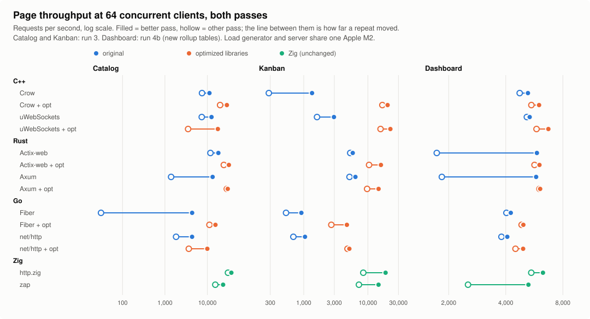
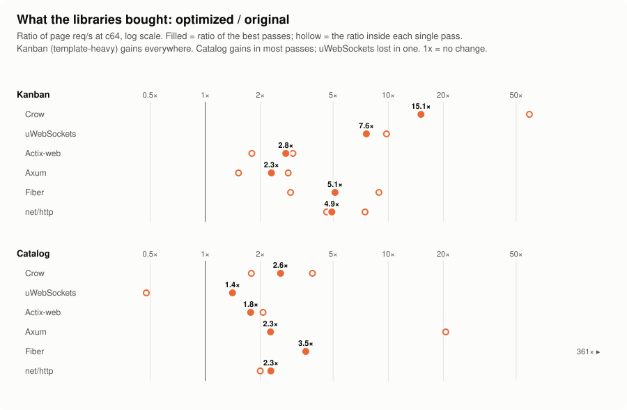
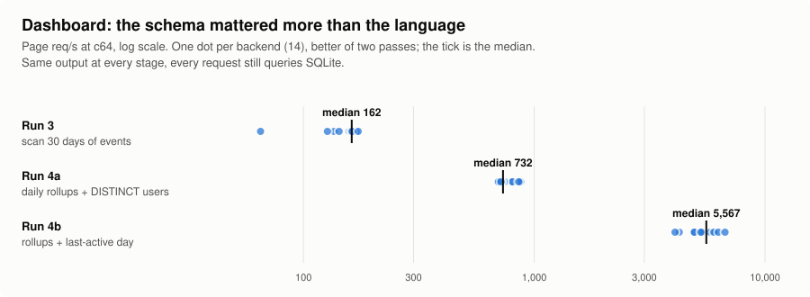
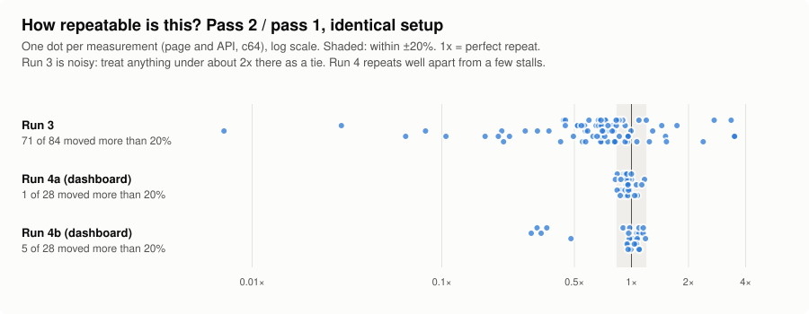

# Best Stack

Measuring the best web stack instead of arguing about it: **11 backends (C++, Rust, Go, Zig) ×
5 frontends × 3 use cases = 165 combinations**, all backed by SQLite, all rendering the *same* pages with the *same*
behaviour, measured from the user's point of view in a real browser, with every raw sample kept in
a SQLite database so the numbers can be re-interpreted later.

## The matrix

| Backends | Frontends | Use cases |
|---|---|---|
| **C++20**: Drogon · Crow · Oat++ · uWebSockets · cpp-httplib<br>**Rust**: Axum · Actix-web<br>**Go**: net/http · Fiber<br>**Zig 0.17**: http.zig · zap | **HTML rendered by the backend**: htmx · Alpine.js · Vanilla TS<br>**SSR on Bun**, data from the backend JSON API: SvelteKit · Astro + Preact islands | Product catalog (read/SEO heavy) · Kanban (write/interaction heavy) · Analytics dashboard (heavy SQL) |

Fairness rules: one core per language (`shared/cpp`, `backends/rust/core`, `backends/go/core`,
`backends/zig/core`: SQLite data layer, HTML, handlers) — within a language backends differ only in
their HTTP layer, routing and concurrency model; across languages every backend passes the same API
contract and uses SQLite 3.54.1 with the same options and pragmas. One stylesheet, one markup spec
([`shared/markup-spec.md`](shared/markup-spec.md)), deterministic seed data. A combination is only
ranked if it passes the functional flow, a pixel diff against the reference (< 0.5 %) and a JS-off
SEO check.

## Layout

```
shared/          schema.sql, seed/ (deterministic data), static/ (css, images, vendored htmx/alpine),
                 cpp/ (bs_core: data layer, inja templates, handlers, chart), markup-spec.md, versions.json
backends/<name>/ C++ adapters (main.cpp); backends/rust|go|zig/ language core + two adapters each;
                 NOTES.md where a framework needed a decision
frontends/       vanilla|alpine|htmx/src (client code for C++-rendered pages), sveltekit/, astro/,
                 shared/ (format, chart, API types), runtime/ (pinned Bun used for SSR servers)
bench/           contract/ (API contract every backend passes), flows/ (Playwright user flows),
                 parity/ (functional, visual, SEO), harness/ (measurement run → results.sqlite)
scoring/         score.ts + weights.json → scores table + results/report.md
docs/superpowers design spec and implementation plan
```

## Running it

Requirements (macOS, Homebrew): `brew install cmake ninja oha asio drogon tokei zig`, Rust, Go, Node ≥ 26, Bun.

```bash
cmake -S . -B build -G Ninja -DCMAKE_BUILD_TYPE=Release && cmake --build build && ctest --test-dir build
bun shared/seed/seed.ts                      # data/pristine.sqlite
bun frontends/build.ts                       # client JS for htmx/alpine/vanilla
backends/rust/build.sh && backends/go/build.sh && backends/zig/build.sh
(cd frontends/runtime && npm ci)             # pinned Bun for the SSR servers
(cd frontends/sveltekit && ../runtime/node_modules/.bin/bun install && ../runtime/node_modules/.bin/bun run build)
(cd frontends/astro && ../runtime/node_modules/.bin/bun install && ../runtime/node_modules/.bin/bun run build)
(cd bench && npm ci && npx playwright install chromium)

bench/scripts/check-backend.sh drogon        # contract + parity for one backend
node bench/harness/run.ts --quick            # smoke run; drop --quick for the full run (hours)
node scoring/score.ts                        # results/report.md from the latest run
```

Ports: C++ backends on `18080`, Bun SSR on `13000`.

## What is measured

- **User (Playwright/Chromium)**, desktop and mobile (4× CPU, ~1.6 Mbps, 150 ms RTT): TTFB, FCP, LCP,
  DCL, load, transferred bytes, JS bytes, requests, long-task total, JS heap; per-step interaction
  latency of each flow (action → expected DOM state).
- **Server (oha)**: req/s and p50/p95/p99 at concurrency 1/16/64 for the page the user hits and for
  the C++ API directly; per-process RSS/CPU/threads/fds sampled every 250 ms (C++ and Bun recorded
  separately).
- **DX**: LOC (tokei), dependency count, clean build time, artifact size, cold start.

Raw tables: `env, combos, parity, starts, page_loads, interactions, load_tests, resources,
dx_components` (see `bench/harness/schema.sql`). Scoring never mutates them; change
`scoring/weights.json` and re-run `score.ts` to re-weigh.

## Results

### Optimized backends and the dashboard bottleneck (runs 3 and 4)

Each language's two fastest paths: C++ with glaze + mimalloc, Rust with askama + mimalloc, Go with templ + go-json, against
unchanged Zig. Server-only, htmx pages, 64 clients, Apple M2. Full report (Turkish): [`docs/results-backend-opt.md`](docs/results-backend-opt.md).

- **Optimized C++ and Rust play in the same league as Zig.** The order within the top six flips between passes, so read it as a tie.
- **The template / view-model layer was the main cost.** Removing it made the Kanban page 2.3–15× faster.
- **Go gained 2.4–2.8× and is still behind.** Its SQLite driver (cgo) may explain part of that; not isolated.
- **On the dashboard, schema beat language:** median 162 → 5,567 req/s from trigger-maintained rollups, versus a 1.6× spread between backends.

<picture><source media="(prefers-color-scheme: dark)" srcset="docs/charts/throughput-dark.svg"></picture>

<picture><source media="(prefers-color-scheme: dark)" srcset="docs/charts/gains-dark.svg"></picture>

<picture><source media="(prefers-color-scheme: dark)" srcset="docs/charts/dashboard-dark.svg"></picture>

**How far to trust this:** differences of 2× or more that show up in both passes. Run 3 is noisy (71 of 84 measurements moved
more than 20% between passes, cause not identified), there are only two passes, and the load generator shares the machine.

<picture><source media="(prefers-color-scheme: dark)" srcset="docs/charts/repeatability-dark.svg"></picture>

Regenerate the charts from the raw data in `docs/data` with `python3 scripts/charts.py`.

### Earlier runs

[`docs/results.md`](docs/results.md): run 2, 165 combinations. [`docs/results-run1.md`](docs/results-run1.md): run 1, C++ only,
with the measurement issues that run 2 fixed. Runs 1–2 used the pre-rollup dashboard schema.
