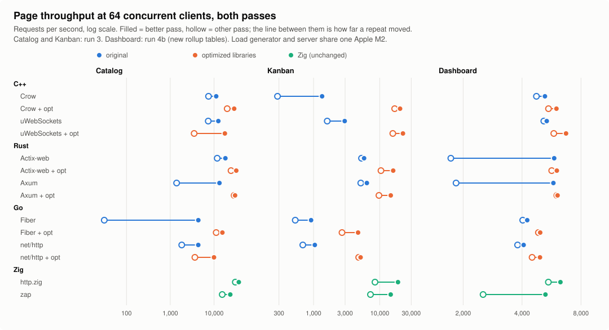
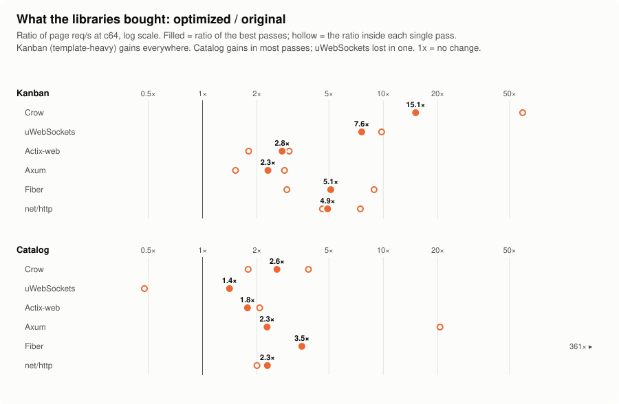
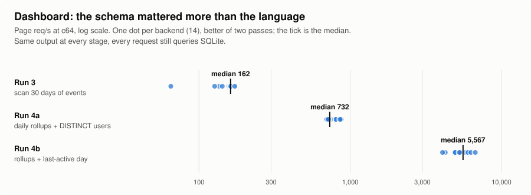
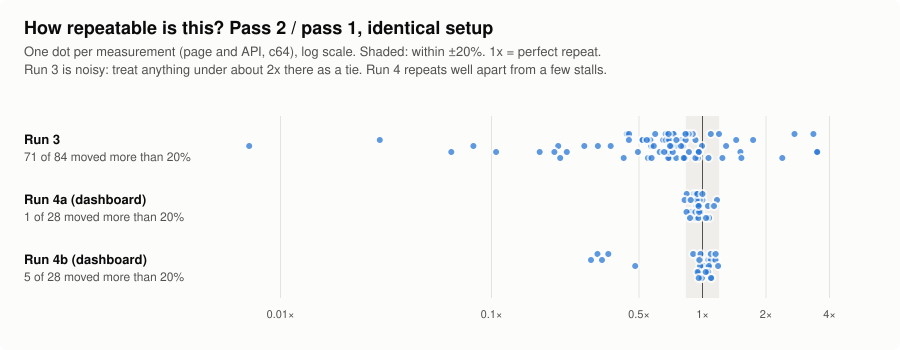

# Best Stack: optimize backend'ler (run 3) ve dashboard darboğazı (run 4)

Soru: C++, Rust ve Go, popüler kütüphanelerle Zig'e ne kadar yaklaşır? Her dilin en hızlı iki yolu hangisi?
Apple M2 (8 çekirdek, 8 GB), macOS 26.7.1, prizde, Düşük Güç Modu kapalı, 2026-11-19. Yalnız sunucu ölçümü (htmx; sayfayı backend üretir), 64 eşzamanlı istemci, ölçüm başına 2 sn ısınma + 10 sn.

| Dil | Framework'ler | Optimize sürümün kütüphaneleri |
|---|---|---|
| C++ | Crow, uWebSockets | glaze + mimalloc; HTML `std::format_to` ile doğrudan tampona |
| Rust | Axum, Actix-web | askama (derleme zamanı şablon) + mimalloc |
| Go | net/http, Fiber | templ (derlenmiş şablon) + goccy/go-json |
| Zig | http.zig, zap | değişmedi (HTML'i zaten doğrudan yazıyor) |

## Bulgular

1. **Optimize C++ ve Rust, Zig ile aynı ligde.** İlk 6 arasındaki sıra turdan tura değişiyor: birinci turda http.zig, ikinci turda Crow (opt) önde. Bunu bir sıralama değil beraberlik olarak okuyun.
2. **En büyük maliyet şablon / görünüm modeli katmanı.** Kanban'da optimize sürüm her turda daha hızlı (en iyi turlara göre 2,3–15×). Katalogda kazanç 1,4–3,5×; tek istisna uWebSockets'in ikinci turu (0,48×).
3. **Go 2,4–2,8× hızlandı ama geride** (ortalama ~6–7 bin; Zig ile optimize C++ ve Rust ~12–16 bin). Bir kısmı dilden değil SQLite sürücüsünden (cgo, `database/sql`) gelebilir; ayrıca ölçülmedi.
4. **Dashboard'da şema dilden daha önemli.** Medyan 162 → 732 → 5.567 req/s (~34×); son aşamada en hızlı ve en yavaş backend arasındaki fark yalnız 1,6×.

<picture><source media="(prefers-color-scheme: dark)" srcset="charts/throughput-dark.svg"></picture>

<picture><source media="(prefers-color-scheme: dark)" srcset="charts/gains-dark.svg"></picture>

### Her dilin en hızlı iki yolu

Katalog, Kanban (run 3) ve Dashboard (run 4b) sayfa req/s geometrik ortalaması. Her hücrede iki turun en iyisi; parantez içi her turun kendi ortalaması.

| Dil | 1. | 2. |
|---|---|---|
| Zig | http.zig: 16.342 (15.586 / 11.769) | zap: 12.208 (10.596 / 7.557) |
| C++ | Crow (opt): 15.211 (13.043 / 14.283) | uWebSockets (opt): 13.863 (13.214 / 7.189) |
| Rust | Actix-web (opt): 14.593 (14.302 / 11.545) | Axum (opt): 13.929 (12.104 / 13.704) |
| Go | Fiber (opt): 7.124 (7.124 / 5.269) | net/http (opt): 6.326 (4.295 / 6.326) |

## Run 4: dashboard darboğazı

<picture><source media="(prefers-color-scheme: dark)" srcset="charts/dashboard-dark.svg"></picture>

| Aşama | Değişiklik | Sorgu CPU süresi / istek (sqlite3 CLI, yaklaşık) | Dashboard sayfa req/s (en iyi tur) |
|---|---|---|---|
| Run 3 | 30 günlük penceredeki 16.809 olay 4 sorguda taranıyor | ~40 ms | 65–173 |
| Run 4a | Trigger ile güncel tutulan günlük özet tablolar | ~8 ms | 696–874 |
| Run 4b | Tekil kullanıcı için `ev_user(last_day, last_purchase_day)` + indeks | ~1 ms | 4.074–6.711 |

- Her istek hâlâ SQLite'a gidiyor, HTTP yanıtı önbelleklenmiyor. Ama özet tablolar bir **ön hesaplamadır**: iş okuma anından yazma anına taşınıyor. Yazma maliyeti ölçülmedi.
- **Varsayımlar:** `events` yalnız ekleniyor ve pencere hep "şimdi"de bitiyor. Biri bozulursa tekil kullanıcı sayısı yanlış olur; keyfi tarih aralığı için bu tablo yetmez.
- Katalog ve Kanban (run 3) şema değişikliğinden önceki kodla ölçüldü; o sorgular değişmedi.

## Bu ölçüm ne kadar güvenilir?

<picture><source media="(prefers-color-scheme: dark)" srcset="charts/repeatability-dark.svg"></picture>

**Sağlam:** aynı iş yapılıyor. Optimize sürümler ve orijinaller 152/152 aynı yanıtı veriyor (son kodla yeniden doğrulandı), 14 backend sözleşme + işlev + görsel + SEO kontrollerinden geçti, yük testlerinde hata yok.

**Zayıf:**
- **Run 3 gürültülü:** 84 ölçümün 71'i iki tur arasında %20'den fazla, 23'ü 2 kattan fazla oynadı; medyan oynama 1,45×. Run 4a (1/28) ve 4b (5/28) çok daha iyi tekrarlandı.
- **Nedeni bilinmiyor.** İkinci turun bir bölümünde (yaklaşık 12:28–12:40 UTC) aynı makinede hafif geliştirme işi (seed testi, SQL denemeleri) de çalıştı; en büyük düşüşler (Fiber, uWebSockets-opt, Axum katalog) ise sonrasında geldi. Uzak masaüstü de açıktı.
- **En iyi tur** bir güven aralığı değildir. Yalnız 2 tur var; yük üreticisi (oha) ile sunucu aynı 8 çekirdeği paylaşıyor.
- macOS, loopback, küçük ve bellekte duran veri, yük altında yalnız okuma. Mutlak req/s üretim tahmini değildir.
- Kod yapay zekâ ajanlarıyla yazıldı; diller arasında emek eşit olmayabilir.

**Söylenebilir:** 2 kat ve üstü, iki turda da görülen farklar. **Söylenemez:** "http.zig Crow'dan hızlı" gibi yakın sıralamalar.

Daha iyisi için: ayrı Linux makine, ayrı yük üreticisi, 5 × 30 sn tekrar ve güven aralığı, Go için farklı SQLite sürücüsü.

### Yöntem notları
- Tutarsız görünen 4 katalog kombinasyonu ayrıca yeniden ölçüldü (`results-run3-recheck.sqlite`). O veri yayımda duruyor ama **buradaki hiçbir sayıda kullanılmıyor**: seçili backend'lere üçüncü bir deneme hakkı verirdi.
- Pilde ve Düşük Güç Modu'nda yapılan ilk deneme geçersiz sayıldı; araç artık bu koşullarda çalışmıyor.
- Bellek (katalog yükünde tepe): http.zig ~8, optimize C++ ~9–12, Go ~20–34, zap ~68, Actix (opt) ~88, Axum (opt) ~212–229 MB. Rust'taki artış büyük olasılıkla mimalloc'tan; ayrıştırılmadı.
- templ, paylaşılan Go bağımlılıklarını yükseltti; orijinaller de bunlarla derlendi. Optimize binary'ler kullanılmayan minijinja/nlohmann kodunu hâlâ içeriyor.
- Run 2 ile mutlak sayılar karşılaştırılmamalı.

Yeniden üretmek için: `python3 scripts/charts.py` ve `python3 scripts/run3_report.py docs/data/results-run3-p1.sqlite:catalog,kanban docs/data/results-run3-p2.sqlite:catalog,kanban docs/data/results-run4b-dashboard-p1.sqlite docs/data/results-run4b-dashboard-p2.sqlite`.
Tasarım: [run 3](superpowers/specs/2026-11-19-run3-optimized-backends.md), [run 4](superpowers/specs/2026-11-19-run4-dashboard-rollups.md).

# Tablolar

Run: `run-2026-11-19T11-15-07-222Z`, `run-2026-11-19T12-19-12-996Z`, `run-2026-11-19T14-12-26-983Z`, `run-2026-11-19T14-31-33-196Z` (her hücre: turların en iyisi)

## Sayfa (HTML) req/s, 64 eşzamanlı istemci: en iyi tur (en düşük tur)

| Backend | Dil | Katalog | Kanban | Dashboard | Katalog API |
|---|---|---|---|---|---|
| http.zig | Zig | 36.737 (30.576) | 18.905 (8.485) | 6.283 (5.452) | 35.490 (30.490) |
| Actix-web (opt) | Rust | 32.229 (24.456) | 16.009 (10.447) | 6.023 (5.670) | 30.811 (21.660) |
| Axum (opt) | Rust | 30.225 (28.784) | 14.717 (9.737) | 6.076 (6.025) | 30.366 (29.159) |
| Crow (opt) | C++ | 28.866 (19.993) | 20.332 (16.835) | 5.996 (5.459) | 32.402 (9.662) |
| zap | Zig | 23.533 (15.388) | 14.671 (7.252) | 5.270 (2.529) | 27.999 (8.018) |
| Actix-web | Rust | 18.187 (11.808) | 5.811 (5.308) | 5.840 (1.730) | 26.866 (11.763) |
| uWebSockets (opt) | C++ | 17.669 (3.512) | 22.466 (15.765) | 6.711 (5.812) | 27.828 (2.286) |
| Fiber (opt) | Go | 15.506 (11.214) | 4.708 (2.691) | 4.953 (4.848) | 19.794 (14.703) |
| Axum | Rust | 13.285 (1.397) | 6.399 (5.179) | 5.785 (1.841) | 28.158 (5.832) |
| uWebSockets | C++ | 12.539 (7.366) | 2.957 (1.611) | 5.349 (5.168) | 23.923 (12.443) |
| Crow | C++ | 11.187 (7.488) | 1.346 (285) | 5.235 (4.738) | 21.318 (14.685) |
| net/http (opt) | Go | 9.972 (3.656) | 5.141 (4.814) | 4.939 (4.502) | 15.850 (14.666) |
| Fiber | Go | 4.375 (31) | 920 (529) | 4.251 (4.031) | 12.514 (370) |
| net/http | Go | 4.367 (1.828) | 1.045 (688) | 4.074 (3.795) | 16.753 (16.059) |

## Optimizasyon kazancı (opt / orijinal, sayfa req/s @64)

| Framework | Kütüphaneler | Katalog | Kanban | Dashboard | Katalog API |
|---|---|---|---|---|---|
| Actix-web | askama + mimalloc | 1,77× | 2,75× | 1,03× | 1,15× |
| Axum | askama + mimalloc | 2,28× | 2,30× | 1,05× | 1,08× |
| Crow | glaze + mimalloc | 2,58× | 15,10× | 1,15× | 1,52× |
| Fiber | templ + go-json | 3,54× | 5,12× | 1,17× | 1,58× |
| net/http | templ + go-json | 2,28× | 4,92× | 1,21× | 0,95× |
| uWebSockets | glaze + mimalloc | 1,41× | 7,60× | 1,25× | 1,16× |

## Gecikme ve kaynak (Katalog sayfası)

| Backend | p50 @1 ms | p95 @64 ms | Bellek MB (yük altında, tepe) | CPU % (ortalama) | İstek başına CPU-µs |
|---|---|---|---|---|---|
| http.zig | 0,12 | 8,07 | 8,2 | 379 | 103,2 |
| zap | 0,13 | 4,67 | 67,8 | 330 | 140,4 |
| Actix-web (opt) | 0,13 | 3,89 | 87,7 | 411 | 127,6 |
| Axum (opt) | 0,13 | 5,51 | 228,8 | 349 | 115,5 |
| Crow (opt) | 0,13 | 3,85 | 11,5 | 333 | 115,5 |
| Fiber (opt) | 0,17 | 9,92 | 20,4 | 414 | 267,2 |
| net/http (opt) | 0,21 | 15,22 | 23,7 | 343 | 344,4 |
| Actix-web | 0,21 | 11,77 | 37,5 | 449 | 246,8 |
| uWebSockets (opt) | 0,26 | 11,21 | 9,2 | 259 | 146,7 |
| Axum | 0,32 | 10,12 | 50,8 | 383 | 288,0 |
| uWebSockets | 0,38 | 9,67 | 10,7 | 500 | 398,6 |
| Crow | 0,39 | 7,95 | 15,0 | 449 | 401,1 |
| Fiber | 0,51 | 47,35 | 33,5 | 420 | 959,2 |
| net/http | 0,57 | 48,76 | 30,5 | 413 | 945,3 |

## Her dilin en hızlı iki yolu (üç senaryonun sayfa req/s @64 geometrik ortalaması)

| Dil | 1. | 2. |
|---|---|---|
| Zig | http.zig — 16.342 | zap — 12.208 |
| C++ | Crow (opt) — 15.211 | uWebSockets (opt) — 13.863 |
| Rust | Actix-web (opt) — 14.593 | Axum (opt) — 13.929 |
| Go | Fiber (opt) — 7.124 | net/http (opt) — 6.326 |

| Sıra | Backend | Geo. ort. sayfa req/s |
|---|---|---|
| 1 | http.zig | 16.342 |
| 2 | Crow (opt) | 15.211 |
| 3 | Actix-web (opt) | 14.593 |
| 4 | Axum (opt) | 13.929 |
| 5 | uWebSockets (opt) | 13.863 |
| 6 | zap | 12.208 |
| 7 | Actix-web | 8.514 |
| 8 | Axum | 7.894 |
| 9 | Fiber (opt) | 7.124 |
| 10 | net/http (opt) | 6.326 |
| 11 | uWebSockets | 5.832 |
| 12 | Crow | 4.288 |
| 13 | net/http | 2.649 |
| 14 | Fiber | 2.576 |

## Hatalar ve eşdeğerlik

- Yük testi hatası olan ölçümler: 0
- Eşdeğerlik (fonksiyonel/görsel/SEO) başarısız kombinasyon: 0 
